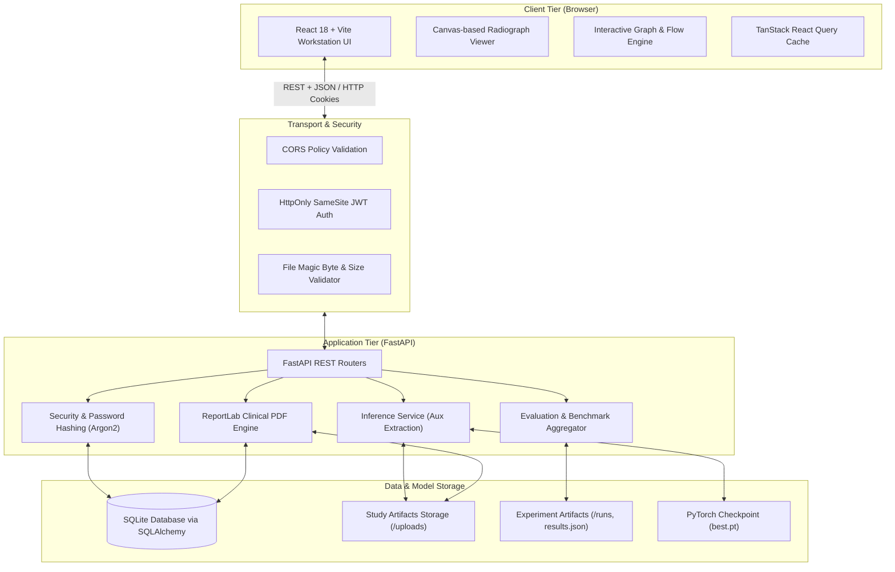
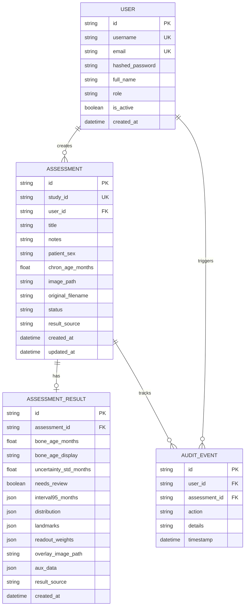

# OSGA-Net Workstation — System Architecture

**Project:** OSGA-Net: Structure-Aware Skeletal Bone Age Assessment  
**Type:** Final-Year Research Workstation & Clinical Explainability Prototype  
**Audience:** ML Engineers, Full-Stack Developers, Clinical Reviewers, Faculty Evaluators  

---

## 1. System Topology & Architectural Overview

The OSGA-Net Workstation is architected as a decoupled, multi-tier system composed of a modern TypeScript/React web application, an asynchronous FastAPI backend service, a persistent SQLite database (SQLAlchemy ORM), and an underlying PyTorch deep learning core (`osga` package).

---

## 2. Component Breakdown

### A. Frontend Application Tier (`osga_net/frontend`)
- **Framework:** React 18, TypeScript, Vite 6.
- **Styling & UI Kit:** Tailwind CSS with custom medical radiology palette (`slate-950` obsidian background, `navy-900` card surfaces, `sky-400` primary clinical accents, `emerald-400` normal ranges, `rose-400` triage/uncertainty flags).
- **Navigation & Layout:** React Router v6 nested inside `AppShell` with persistent `DisclaimerBanner` ("Research prototype - not for clinical decisions") and `ModeBadge` (`real_inference`, `demonstration`, `integration_pending`).
- **Interactive Visualizers:**
  - `ImageViewer.tsx`: High-performance HTML5 canvas viewer with pan, zoom, inverted contrast, and pixel-space overlay coordinate rendering.
  - Coordinate re-projection math: Translates model's normalized padded square coordinates $(x_{\text{norm}}, y_{\text{norm}}) \in [0, 1]$ back to unpadded original radiograph pixel space $(x_{\text{orig}}, y_{\text{orig}})$.
  - Charting: Recharts for 228-bin ordinal probability distribution histograms and cumulative density functions.

### B. Backend REST Service (`osga_net/backend`)
- **Framework:** FastAPI with Python 3.10+ async support and Pydantic v2 schemas.
- **Security:**
  - Password hashing: Argon2 via `pwdlib[argon2]`.
  - Session authentication: Signed HS256 JWT tokens transmitted exclusively via `httpOnly`, `SameSite=lax` secure cookies (strictly avoiding `localStorage` token leakage).
  - Multi-tenant tenant isolation: Each database record (`Assessment`, `AssessmentResult`) is tied to `user_id`. Queries strictly filter by current user.
- **Inference Lifecycle (`InferenceService`):**
  - Singleton pattern: Initializes `BoneAgePredictor` once on startup or when `CKPT_PATH` is supplied.
  - Checkpoint-agnostic: Gracefully operates in `demonstration` or `integration_pending` mode when no checkpoint is present, preventing crashes.
  - Additive auxiliary extraction: Invokes model with `return_aux=True` to harvest intermediate activations (RoI bounding boxes, GAT multi-head attention weights, FiLM scale/shift parameters, feature norms) without altering downstream predictions.
- **Evaluation & Benchmark Aggregator (`EvaluationService`):**
  - Reads published metrics from Table IV (Mao et al., Pan et al., Chen et al., etc.).
  - Aggregates ablation runs from `runs/<variant>/metrics_<split>.json` and `results/results.json`.
  - When checkpoints or evaluation runs have not been completed, explicitly displays "Evaluation pending" — zero fabricated numbers.
- **Clinical Report Engine (`ReportService`):**
  - Generates multi-page vector PDF reports using `reportlab`.
  - Embeds study metadata, radiograph thumbnail with ossification markers, predicted bone age vs chronological reference, uncertainty standard deviation, and full legal disclaimers.

---

## 3. Database Schema & Data Models

The persistence layer uses SQLite via SQLAlchemy ORM.

---

## 4. End-to-End Inference & Visualization Pipeline

1. **Upload & Ingestion:**
   - Radiograph uploaded to `POST /api/assessments/{id}/image`.
   - Backend validates magic bytes (`\x89PNG\r\n\x1a\n` or `\xff\xd8\xff`), file size limit (`MAX_UPLOAD_MB`, default 20MB), and image dimensions.
   - Raw image saved securely to disk under `uploads/<id>.<ext>`.

2. **Preprocessing (`osga/dataset.py:prepare_image`):**
   - 8-bit Grayscale conversion.
   - Contrast Limited Adaptive Histogram Equalization (CLAHE: clip limit 2.0, $8 \times 8$ grid).
   - Median border padding to square aspect ratio, tracking offsets $(pad_x, pad_y)$ and scale $S$.
   - Resize to model input dimension $H \times W$ (default $384 \times 384$).
   - 3-channel replication and ImageNet normalization.

3. **Forward Pass & Auxiliary Extraction:**
   - EfficientNetV2-S extracts multi-scale feature maps; landmark head predicts 13 heatmaps at stride 8 ($48 \times 48$).
   - Soft-argmax extracts normalized coordinate centroids $(x_i, y_i) \in [0, 1]$.
   - Detached coordinates form bounding boxes for RoIAlign pooling ($2 \times 2$ output).
   - FiLM layers modulate node features using demographic embeddings:
     $$x'_i = (1 + \gamma_i) \odot x_i + \beta_i$$
   - 2-layer, 4-head Graph Attention Network (GAT) computes edge attention across the 20 skeletal edges.
   - 228-bin Ordinal Softmax head outputs discrete probability distribution $p(k)$ for months $k \in [1, 228]$.
   - Expected bone age: $\hat{\mu} = \sum_{k=1}^{228} k \cdot p(k)$.
   - Uncertainty standard deviation: $\hat{\sigma} = \sqrt{\sum_{k=1}^{228} p(k) (k - \hat{\mu})^2}$.

4. **Coordinate Transformation & Client Rendering:**
   - Unpadding math converts landmark coordinates and RoI boxes back to the radiograph's original pixel grid:
     $$x_{\text{orig}} = \frac{x_{\text{norm}} \cdot S - pad_x}{w} \cdot w_{\text{orig}}$$
   - Client renders anatomical landmarks and attention-sized ossification rings on the interactive viewer canvas.
